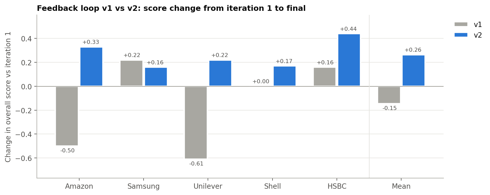

# Loop comparison: v1 vs v2

| Metric | v1 | v2 |
|---|---|---|
| Mean initial score | 3.46 | 3.35 |
| Mean final score | 3.31 | 3.61 |
| Mean change | -0.15 | +0.26 |
| Companies improved | 2/5 | 5/5 |
| Companies converged | 0/5 | 0/5 |
| Mean rounds | 3.0 | 3.0 |
| Inconsistencies (final, total) | 16 | 15 |
| Words per section (final) | 1022 | 711 |

| Company | v1 initial → final | v1 change | v2 initial → final | v2 change |
|---|---|---|---|---|
| Amazon | 3.11 → 2.61 | -0.50 | 2.78 → 3.11 | +0.33 |
| Samsung | 3.45 → 3.67 | +0.22 | 3.56 → 3.72 | +0.16 |
| Unilever | 3.50 → 2.89 | -0.61 | 3.22 → 3.44 | +0.22 |
| Shell | 3.78 → 3.78 | +0.00 | 4.00 → 4.17 | +0.17 |
| HSBC | 3.45 → 3.61 | +0.16 | 3.17 → 3.61 | +0.44 |

## Is the difference bigger than the assessor's own variation?

Re-scoring the same text changes a report score by **0.15** on average (section: 0.19, 15 sections re-scored). Changes smaller than this are within measurement noise.

